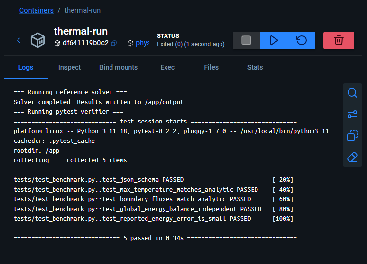

# Docker Thermal Benchmark

A containerized scientific-computing benchmark: solve a 1D steady heat-conduction problem with temperature-dependent conductivity, then verify the answer with pytest against an exact analytic solution.

## How it works

- solution/reference_solver.py: finite-difference solver using a Newton-type root finder
- tests/test_benchmark.py: verifier that compares the output to the exact Kirchhoff-transform solution, not to the solver's own numbers
- Dockerfile and run_benchmark.sh: run the solver, then the verifier, in a pinned environment
- task_spec.md: the full problem statement

## Results

- Peak temperature 323.92 K, an interior maximum that matches the analytic value
- Boundary heat fluxes about -2411.7 and 771.7 W/m2, within about 0.01% of the analytic values
- 5 pytest checks pass

## Run with Docker

    docker build -t physics-benchmark:v1 .
    docker run --rm physics-benchmark:v1

## Run without Docker

    export BENCH_OUTPUT_DIR=./out
    python solution/reference_solver.py
    python -m pytest tests/

## Container run

The image builds and passes all five checks inside Docker.

